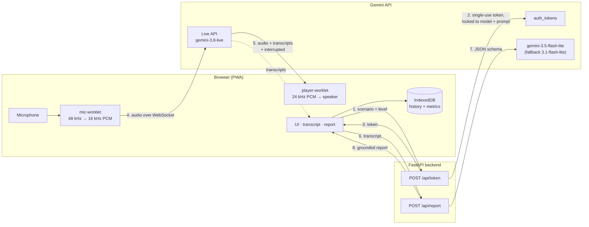

# Lucia · real-time English speaking coach

Lucia is an installable web app (PWA) for practising spoken English. You pick a situation (a job interview, ordering at a café, small talk, a business meeting), talk out loud with an AI voice tutor in real time, and get a written report on your English when you finish.

- **Real-time voice**: talk and listen with [Gemini Live](https://aistudio.google.com/docs/live-api). You can interrupt the tutor mid-sentence (barge-in), and both sides of the transcript appear live on screen.
- **Report that sticks to what you said**: grammar fixes (your sentence → corrected → why), more natural phrasing, words to keep, and fluency/accuracy scores from 0 to 100. Every quoted sentence is checked against the transcript on the server. Anything the model invents is dropped.
- **History and progress**: conversations and reports are stored on the device (IndexedDB), with a score-over-time chart.
- **Measured**: every conversation records connect time, time to first voice reply, reply delay per turn, token usage and estimated cost. A Metrics screen summarises them.
- **Works offline where it can**: the app shell, history and metrics open without internet. The conversation screen says it needs a connection.

No build step: the frontend is plain HTML, CSS and ES modules. The backend is a small FastAPI service.

## Architecture



1. The browser asks the backend for a token for one scenario and level.
2. The backend creates a **single-use ephemeral token** (one session, must be used within 1 minute, expires in 10 minutes). The token **locks** the model, the scenario's system prompt and the transcription settings, so it can't be reused as a general-purpose voice bot. The API key never leaves the server.
3. The browser opens a WebSocket straight to the Live API with that token. Audio does not pass through our server, which saves a network hop.
4. An `AudioWorklet` downsamples the microphone to 16 kHz 16-bit PCM and sends ~32 ms chunks.
5. The tutor's 24 kHz audio plays through a second worklet with a ring buffer. When the server sends `interrupted` (the learner started talking), the buffer is cleared immediately. That's what makes barge-in feel instant.
6. When the conversation ends, the transcript goes to `/api/report`.
7. The report model answers in JSON that has to match a Pydantic schema (`response_schema`). Output that doesn't parse or is out of range is rejected.
8. Grounding check: every `original` quote must appear in the learner's own lines (ignoring case and punctuation), and every vocabulary word must come from the conversation or from a kept correction. Everything else is removed and counted.

### Design decisions worth knowing

| Decision | Why |
| --- | --- |
| Browser connects to Gemini directly with an ephemeral token | Lowest latency, no audio relay to host or pay for. The token is single-use and locked to the scenario. |
| `VERBATIM` input transcription | The default transcription quietly "fixes" learner mistakes ("I goed" → "I go"), which hid them from the report. Found while testing. |
| Server-side grounding of the report | The model must not invent mistakes. Unverifiable items are dropped, and the UI says how many. |
| Report model fallback | During testing `gemini-3.5-flash-lite` returned `503 high demand`. On 429/500/503 the backend retries with `gemini-3.1-flash-lite`. |
| Speaker mode | Without headphones the mic hears the tutor. While the tutor talks, quiet mic audio is muted so the tutor doesn't interrupt itself, but you can still cut in by speaking up. Learner lines that mostly repeat what the tutor said in the last 20 s are greyed out and left out of the report. This filter is adapted from my earlier Jarvis phone add-on. |
| One `AudioContext`, created on tap | iOS Safari only starts audio inside a user gesture and is unreliable with several contexts. |
| `entitlements.py` returns a `Plan` | There are no accounts yet. Session limits come from the plan, so Stripe subscriptions can be added later without touching the routers. |

## Measured latency and cost

Measured on 3 Nov 2026 with two ~75-second café conversations: Windows 11 desktop, Chromium, home internet in Turkey. The learner's side was a synthetic English speech recording (Windows TTS) fed in place of the microphone, so the runs are repeatable. A real-microphone conversation was also tested in Chrome, but its numbers aren't included here.

| Metric | Result |
| --- | --- |
| WebSocket connect + setup | 932 ms and 970 ms |
| Tap "Start" → tutor's first audio | 1.47 s and 1.71 s |
| Reply delay (end of learner speech → first tutor audio), 8 turns | median **≈1.55 s**, range 1.31–1.83 s |
| Tokens per conversation (Live + report) | 7,817 and 10,717 |
| Estimated cost on Gemini's paid tier | $0.023 and $0.031 per conversation → **≈$0.021 per minute** |
| Cost on the free tier | $0 |

Notes:
- Reply delay includes the time the server's voice-activity detection waits to decide you've stopped talking. It's what the learner actually experiences, not just model time.
- When the model starts answering while the learner is still talking (a reply less than 200 ms after the last voiced audio), that turn is counted as an overlap, not as a reply delay.
- Cost uses the prices in [`frontend/js/metrics.js`](frontend/js/metrics.js) ([pricing page](https://aistudio.google.com/docs/pricing), checked Nov 2026). The Live API reports usage per turn, and each turn re-reads the conversation so far, so per-turn usage is summed. Thinking tokens are billed at the text-output rate.
- Audio input dominates the cost, because the whole history is re-read on every turn. Context-window compression is the obvious next step for longer sessions.

## Run it locally

Requirements: Python 3.12+, a Gemini API key from [Google AI Studio](https://aistudio.google.com/apikey).

```bash
cd backend
python -m venv .venv
.venv\Scripts\activate            # macOS/Linux: source .venv/bin/activate
pip install -r requirements-dev.txt
copy .env.example .env            # macOS/Linux: cp .env.example .env
# put your key in backend/.env → GEMINI_API_KEY=...
uvicorn app.main:app --port 8000
```

In a second terminal, serve the frontend (any static server works):

```bash
python -m http.server 5500 --directory frontend --bind 127.0.0.1
```

Open http://localhost:5500 in Chrome, Edge or Safari and allow the microphone. `localhost` counts as a secure context, so microphone access works without HTTPS.

**Testing without a microphone:** put a speech recording in `frontend/test-audio/` and open `http://localhost:5500/?fake=test-audio/your-file.wav`. The recording replaces the microphone. This only works on localhost, and the conversation screen shows a "Test mode" warning.

### Configuration (`backend/.env`)

| Variable | Default | Purpose |
| --- | --- | --- |
| `GEMINI_API_KEY` | – | Required. Stays on the server. |
| `LIVE_MODEL` | `gemini-3.8-live` | Voice model |
| `REPORT_MODEL` / `REPORT_FALLBACK_MODEL` | `gemini-3.5-flash-lite` / `gemini-3.1-flash-lite` | Report models |
| `ALLOWED_ORIGINS` | `http://localhost:5500,...` | CORS allow-list (comma-separated) |
| `ACCESS_CODE` | empty | When set, the API requires the `X-Access-Code` header. The app asks for the code once and remembers it. Protects the free quota on a public demo. |
| `TRUST_PROXY` | `false` | Set `true` behind Render's proxy so rate limits use the real client IP |

## Deploy

- **Frontend → GitHub Pages:** [`.github/workflows/pages.yml`](.github/workflows/pages.yml) publishes `frontend/` on every push to `main`.
- **Backend → Render (free web service):** [`render.yaml`](render.yaml) is a Blueprint. Set `GEMINI_API_KEY` (and optionally `ACCESS_CODE`) in the Render dashboard. `ALLOWED_ORIGINS` should be the Pages origin, and `API_BASE` in [`frontend/js/api.js`](frontend/js/api.js) the Render URL.
- **CI:** [`.github/workflows/tests.yml`](.github/workflows/tests.yml) runs the backend tests.

## Tests

```bash
cd backend
pytest
```

28 tests, all with Gemini mocked:
- token endpoint: scenario lock, no key leakage, 404/422/502/503, access code, rate limit, CORS allow-list
- report endpoint: schema validation (bad JSON, missing fields, out-of-range scores), dropping invented mistakes, too-short conversations
- `GeminiService`: model fallback on 503 but not on 400, JSON schema config, token locked to `VERBATIM` transcription

## Project layout

```
backend/
  app/
    main.py            FastAPI app, CORS, /health
    config.py          settings from env / .env
    gemini.py          the only module that calls Gemini (tokens, reports, fallback)
    scenarios.py       role-play prompts per scenario and CEFR level
    report_schema.py   report schema + grounding check
    ratelimit.py       in-memory sliding-window limiter
    entitlements.py    plan limits (Stripe-ready seam)
    routers/           /api/token, /api/report
  tests/
frontend/
  index.html, manifest.webmanifest, sw.js, css/, icons/
  js/
    app.js             views and routing
    session.js         one conversation: mic ↔ Live ↔ speaker ↔ transcript ↔ metrics
    live.js            raw-WebSocket Live API client
    transcript.js      turn assembly + echo filter
    metrics.js         latency, usage and cost
    db.js, chart.js, api.js, scenarios.js
    audio/             AudioWorklets (mic downsampling, playback ring buffer)
scripts/make_icons.py  draws the PNG icons with no image library
```

## Known limitations

- **Not yet tested on an iPhone.** The code follows Safari's rules (audio started inside a tap, one `AudioContext`, safe-area layout), but real iOS testing is still to do. On iOS, audio stops when the screen locks.
- Sessions are capped at 10 minutes, and there is no session resumption yet. The Live connection is recycled by the server after about 10 minutes anyway.
- Speech recognition errors can end up in the report. Synthetic speech saying "goed" was transcribed as "go", and pure digital silence was once transcribed as "Hi."
- The echo filter is a heuristic. Headphones still give the best experience.
- Rate limiting is in memory, per server instance.
- On free hosting the backend sleeps when idle. The app pings `/health` on start-up, but the first token request after a long idle period can still take extra seconds.
- **Privacy:** Google may use data sent on the Gemini free tier to improve its products. Don't practise with anything you wouldn't want stored. History stays on your device. The backend doesn't store transcripts. It logs request metadata and errors, and when a report fails schema validation it logs the first 500 characters of the model's output.

## Roadmap

- Accounts and a Stripe test-mode subscription (plan limits via `entitlements.py`)
- Session resumption and context-window compression for longer, cheaper sessions
- Per-turn pronunciation feedback
- A latency dashboard comparing Live models

---

Built by Batuhan Kul.
